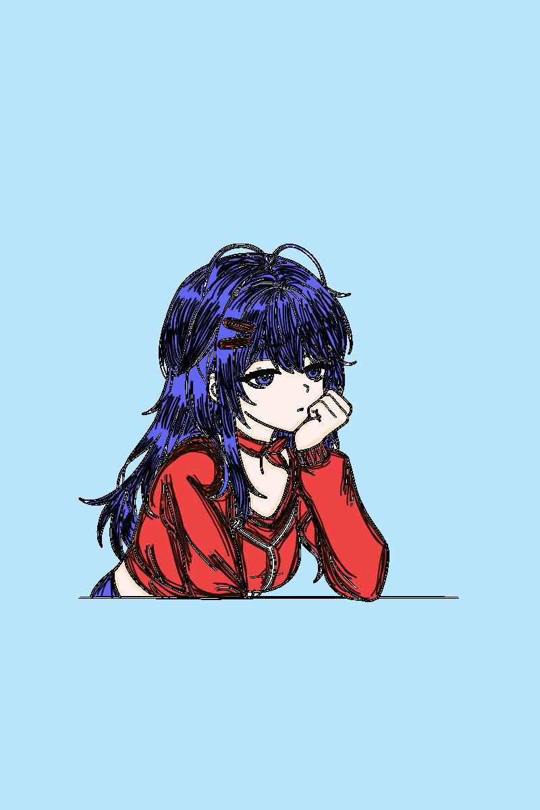

  

  
  

  

 
  <a href="https://luizangelomartins.github.io/colori-system-test/">
   

## 🚀 Principais Funcionalidades

* **Modos de Pintura Variados:** Ferramentas de Pincel Livre, Giz de Cera, Aquarela, Spray/Aerógrafo, Pincel Arco-Íris e Efeito Neon/Glow.
* **Balde de Preenchimento Inteligente:** Sistema de *Flood Fill* otimizado com sensibilidade de borda, detecção de contornos e proteção contra vazamento.
* **Ferramenta Conta-Gotas:** Seleção rápida de cores diretamente da tela para pintura contínua.
* **Navegação Fluida (Pan & Zoom):** Movimentação livre pelo canvas com suporte a toque e mouse.
* **Conferência com Imagem Original:** Botão dedicado para alternar instantaneamente entre a arte colorida e a foto de referência original, mantendo todas as ferramentas de movimento ativas.
* **Sistema de Projetos (.JSON):** Salve e carregue seu progresso de pintura a qualquer momento através de arquivos de projeto compactos.
* **Segurança e Acesso:** Tela de login integrada com validação via hash MD5 e controle de tentativas.
* **Exportação em Alta Qualidade:** Salve sua arte finalizada diretamente em PNG.

## 🛠️ Tecnologias Utilizadas

* **HTML5 Canvas** (Renderização gráfica de alta performance)
* **Tailwind CSS** (Interface moderna e responsiva em modo escuro)
* **FontAwesome** (Ícones interativos)
* **SparkMD5** (Segurança e autenticação de acesso)
